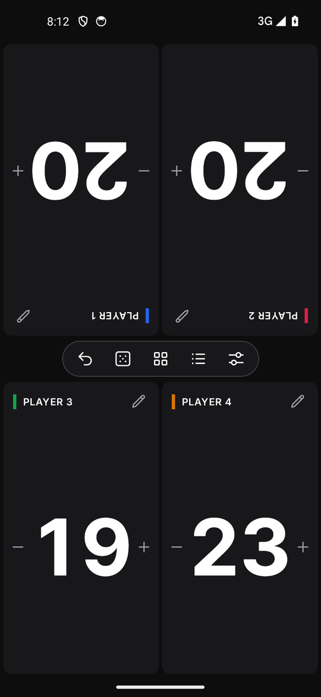
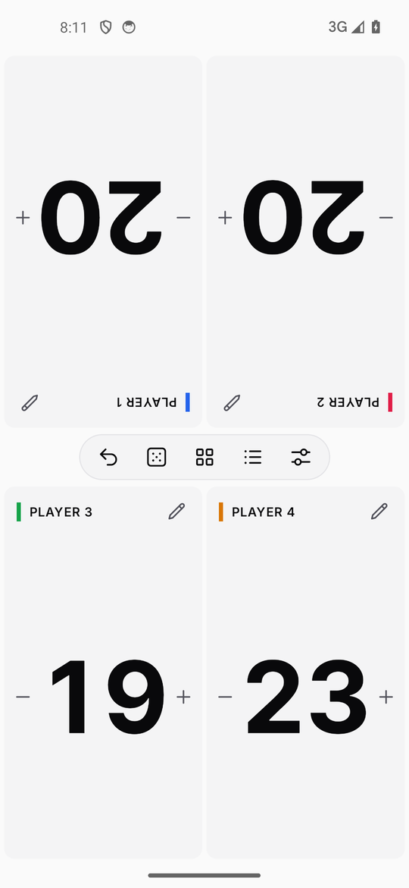

<p align="center">
  
</p>

<h1 align="center">Chronoscore</h1>

<p align="center">
  Offline scorekeeper for tabletop, card and board games: one shared screen, 1–8 players, no network.<br>
  Android 7.0+ · Windows · Linux · one Compose Multiplatform (Kotlin) codebase
</p>

<p align="center">
  
  
  
</p>

## Download

Get the latest build from [**Releases**](https://github.com/MGriot/Chronoscore/releases/latest):

| Platform | File | Notes |
| --- | --- | --- |
| Android 7.0+ | `Chronoscore-1.0.0.apk` | Signed release build. Allow installs from your browser or file manager, then open the file. |
| Windows x64 | `Chronoscore-windows-x64-1.0.0.jar` | Needs Java 17+. Run it with `java -jar Chronoscore-windows-x64-1.0.0.jar`. |

To get a Linux build, or a native Windows installer, build it from source (see below).

## Features

- **1–8 seats on one screen.** Seats in the top half face the far side of the table, and each seat can be rotated 180°.
- **Counting by touch:**
  - Tap the left half of a seat for −1 or the right half for +1.
  - Hold to repeat. After about a second it speeds up to steps of ±5.
  - A running delta shows next to the name until you pause.
- **Keypad** to set a value or add/subtract an amount, on one seat or on all seats.
- **Up to 4 counters per seat**, such as Poison, Commander, Energy, VP, Fouls or Tax, plus custom ones.
- **Edit all seats:** change a score or counter across the table in one step. One undo reverts the whole change.
- **Table utilities:** d4–d20, custom dX up to d1000, several dice per roll, a coin flip, a first-player picker and a turn-order shuffle.
- **Match log:** changes grouped by round, with single-step undo.
- **Saved matches:** every match keeps its own history, grouped by game (for example Catan or Commander), and any match can be continued.
- **Neutral or Colored seat style**, plus System, Dark or Light theme.
- **Fully air-gapped:**
  - The Android app has no `INTERNET` permission and turns off cloud backup.
  - Data lives only in a local SQLite database.

See the **[User guide](docs/USER_GUIDE.md)** for a walkthrough with screenshots.

<p align="center">
  
</p>

## Build from source

You need JDK 17+. For the Android build you also need the Android SDK, with `sdk.dir` set in `local.properties`.

```bash
./gradlew :composeApp:run                         # run on desktop
./gradlew :composeApp:desktopTest                 # unit, database and offscreen UI render tests
./gradlew :composeApp:assembleDebug               # Android debug APK
./gradlew :composeApp:assembleRelease             # Android release APK (signed if keystore.properties exists)
./gradlew :composeApp:packageUberJarForCurrentOS  # desktop JAR for this OS
./gradlew :composeApp:packageMsi                  # Windows installer (packageDeb / packageRpm on Linux)
```

Release signing reads `keystore.properties` from the repo root. That file is git-ignored and has these keys:

```properties
storeFile=keystore/chronoscore-release.jks
storePassword=…
keyAlias=chronoscore
keyPassword=…
```

Native installers are built for the OS and CPU architecture of the build host. For example, Linux ARM64 packages have to be built on an ARM64 machine.

Desktop data is stored in these locations:

| Platform | Database |
| --- | --- |
| Windows | `%APPDATA%\Chronoscore\chronoscore.db` |
| Linux | `$XDG_DATA_HOME/chronoscore/` (default `~/.local/share/chronoscore/`) |

Pass `-Dchronoscore.db=<path>` to override the location.

## Project layout

Everything lives in `composeApp/src/commonMain/kotlin/io/chronoscore/`:

| Path | Contents |
| --- | --- |
| `model/` | Immutable data models |
| `engine/` | The pure reducer (`GameEngine.reduce`): coalescing, batch undo, bulk edits |
| `random/` | Dice, coin and seat randomizers |
| `data/` | The SQLDelight repository, with migrations in `sqldelight/…/1.sqm` |
| `viewmodel/` | The `StateFlow` ViewModel: autosave, library, settings |
| `ui/` | The board, dialogs, and the design system (`ui/theme`) |

Other folders:

| Path | Contents |
| --- | --- |
| `docs/ui-kit/` | The Chronoscore UI Kit the interface follows |
| `tools/` | Icon and documentation image generators |

## Credits

Fonts: [Inter and Inter Tight](https://github.com/rsms/inter), SIL Open Font License 1.1 (see `docs/licenses/Inter-OFL.txt`).
