<p align="center">
  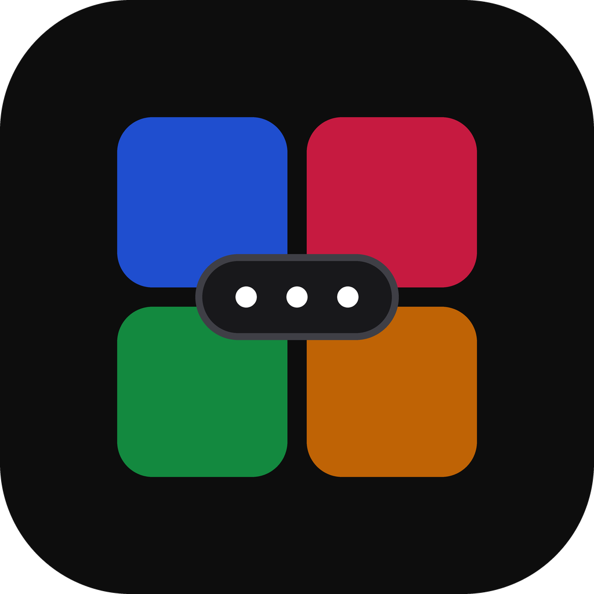
</p>

<h1 align="center">Chronoscore</h1>

<p align="center">
  Offline scorekeeper for tabletop, card and board games: one shared screen, 1–8 players, no network.<br>
  Android 7.0+ · Windows · Linux · one Compose Multiplatform (Kotlin) codebase
</p>

<p align="center">
  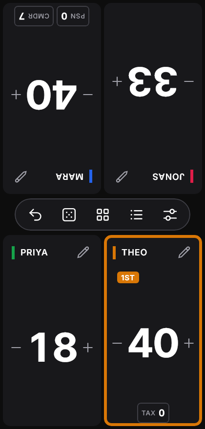
  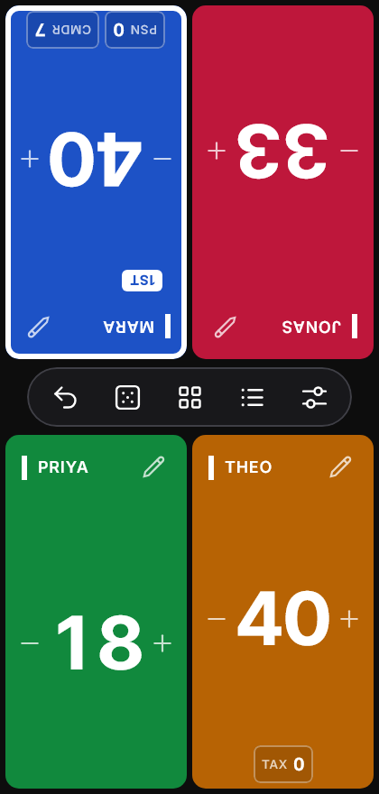
  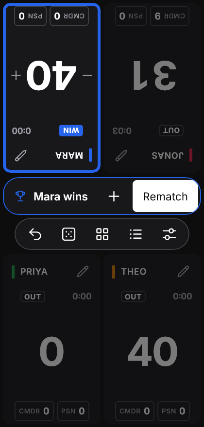
</p>

## Download

Get the latest build from [**Releases**](https://github.com/MGriot/Chronoscore/releases/latest):

| Platform | File | Notes |
| --- | --- | --- |
| Android 7.0+ | `Chronoscore-1.3.0.apk` | Signed release build. Allow installs from your browser or file manager, then open the file. |
| Windows x64 | `Chronoscore-1.3.0.exe` | Installer with its own Java runtime, so you don't need Java. Adds Chronoscore to the Start menu. |
| Windows x64 (portable) | `Chronoscore-windows-x64-1.3.0.jar` | Needs Java 17+. Run it with `java -jar Chronoscore-windows-x64-1.3.0.jar`. |

To get a Linux build, build it from source (see below).

## Features

- **1–8 seats on one screen.** Seats in the top half face the far side of the table, and each seat can be rotated 180°.
- **Counting by touch:**
  - Tap the left half of a seat for −1 or the right half for +1.
  - Hold to repeat. After about a second it speeds up to steps of ±5.
  - A running delta shows next to the name until you pause.
- **Keypad** to set a value or add/subtract an amount, on one seat or on all seats.
- **Up to 4 counters per seat**, such as Poison, Commander, Energy, VP, Fouls or Tax, plus custom ones.
- **Edit all seats:** change a score or counter across the table in one step. One undo reverts the whole change.
- **Table utilities:** d4–d20, custom dX up to d1000, several dice per roll, a coin flip, a first-player picker and a turn-order shuffle.
- **Match log:** changes grouped by round, with single-step undo.
- **Saved matches:** every match keeps its own history, grouped by game (for example Catan or Commander), and any match can be continued.
- **Neutral or Colored seat style**, plus System, Dark or Light theme.

New in 1.1. Each of these is optional and set per match:

- **Turn tracker:** an active seat with Previous / Next buttons. After the last seat the round advances.
- **Timers:** a match clock, seat timers (chess-clock style) and an optional turn limit, with pause and resume.
- **Win rules:** first to a target score (highest or lowest wins), elimination, or (1.3) out at or above a score. Dimmed seats are out, a banner names the winner, and Undo revives.
- **Presets:** Commander, Magic 1v1, Hearts, Race to 10, Catan, Carcassonne, Uno, Rummy 500, Skyjo, Chess clock and Board game timer, plus your own.
- **Round sheet:** a scorepad of points per round with totals.
- **Magic: The Gathering extras:** per-opponent commander damage, Monarch, Initiative and Day/Night.
- **Players & stats:** saved players and their wins, win rate, averages and time on turns.
- **Backups:** export and import everything as a JSON file, or a match as CSV, through the system file picker.
- **Fully air-gapped:**
  - The Android app has no `INTERNET` permission and turns off cloud backup.
  - Data lives only in a local SQLite database.

New in 1.2:

- **Timer mode:** a chess clock for 1–8 seats. Each seat counts down its own bank, with an optional Fischer increment or delay. A seat that runs out is either out or plays on in overtime. Tap your tile to end your turn.
- **Seats turn in 30° steps**, so a seat can face a player at any side or corner of the table.
- **Game name on the table:** name the current match from the menu. It shows on the hub and in the match log, with a confirmation. Starting a new game asks for a second tap and keeps the old match in Saved matches.
- **Delete a game** (1.2.1): remove every match filed under a game from Saved matches.
- **Start screen** (1.2.2): when the app opens, choose to continue the last match, start a new game or pick one from Saved matches.

New in 1.3:

- **Teams:** a seat can be a team (Scopone, Burraco in pairs, bocce teams). Members share the seat's score, and stats count the result for each of them. Choose *Teams of 2* or *3* in New game, or turn any seat into a team from its editor.
- **Darts**, entered one dart at a time on a board keypad (Single / Double / Treble, 1–20, bull, miss):
  - **X01** (301, 501, 701) with double-out, optional double-in, busts and checkout hints;
  - **Cricket** with marks on 15–20 and the bull;
  - **Around the Clock** and **Shanghai**, including the Shanghai knockout.
  The turn passes after three darts, and Undo takes back one dart, bust or win included.
- **Hand calculators** for the round sheet: tap a round to score a hand of **Scopa / Scopone** (cards, denari, settebello, primiera, scope), **Burraco** (burrachi, closing, pozzetto, cards on the table and in hand), **Briscola** (61 of 120), **bocce** (points for the closest side) or **Scala 40** (penalties, 100 for not opening).
- **Out at or above** a score, for penalty games like Scala 40 (out at 101).
- **New presets:** Bocce · Raffa (12), Pétanque (13), Briscola, Scopa (11), Scopone, Scala 40, Burraco (2005), Darts 501 and 301, Cricket, Around the Clock and Shanghai.
- **Faster from launch to the table:**
  - **Home** has *Quick start* tiles: the game on the table and your recent games or presets start in **one tap**, with the same players. Long-press a tile to change the setup first.
  - **New game** is a two-step setup, *Game* then *Players*, where you name and colour each seat before the match starts. **Start** stays in view and needs one tap.
  - A decided match offers **Rematch** and **New game** right in the result bar.
  - The **Menu** fits one phone screen. **Appearance** has its own screen, and *Reset scores* sits apart at the bottom.
- **Easier to read at the table:**
  - The score always keeps at least half its seat. Counters that don't fit shrink to small chips, and every seat shows its score at the same size.
  - On phones, names get the whole seat header (tags and timers move to a line below), and seats turn in right angles.
  - The turn bar shows a white **Start** button while paused, and a sun or moon for Day/Night.
  - The round sheet marks the leader and shows progress toward the target.
  - Darts has bigger keys, the last three visits, a separate Undo key, and cricket marks lined up under each player.
  - Presets are grouped by category, and selected options carry a check mark.

<p align="center">
  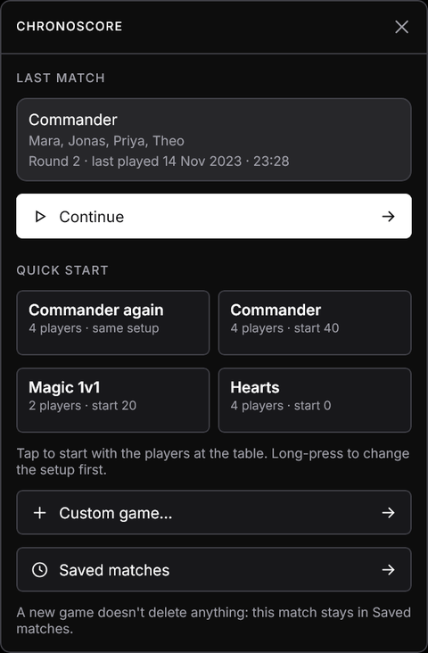
  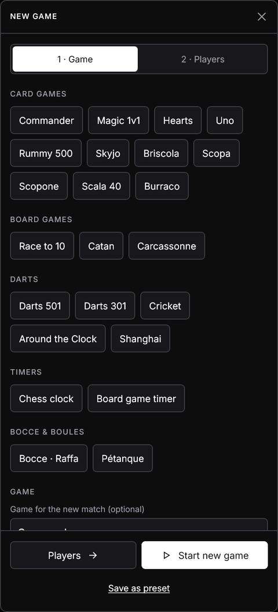
  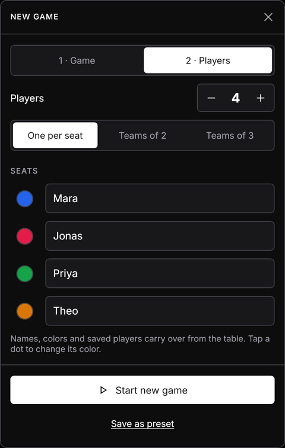
</p>

<p align="center">
  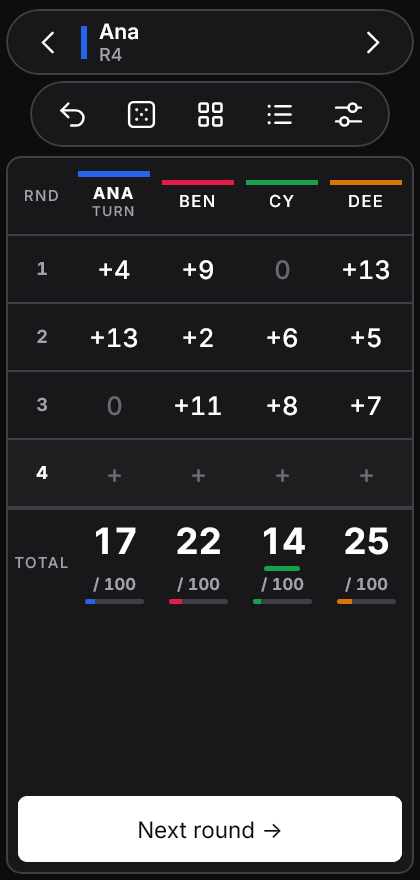
  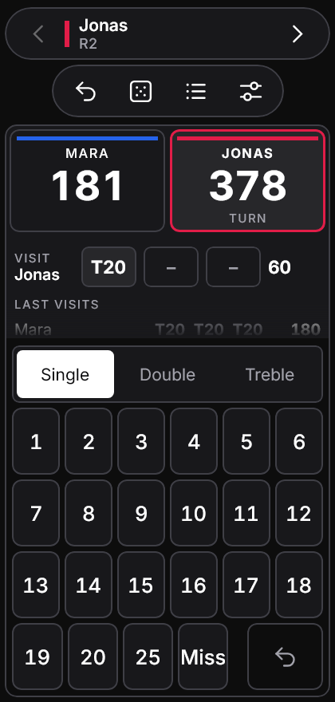
  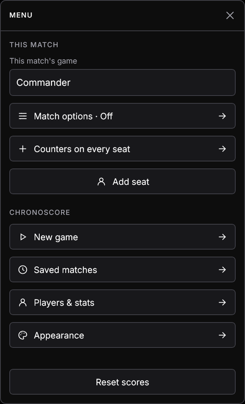
</p>

See the **[illustrated HTML guide](docs/guide/index.html)** (open it in a browser) or the **[User guide](docs/USER_GUIDE.md)** for a walkthrough with screenshots.

<p align="center">
  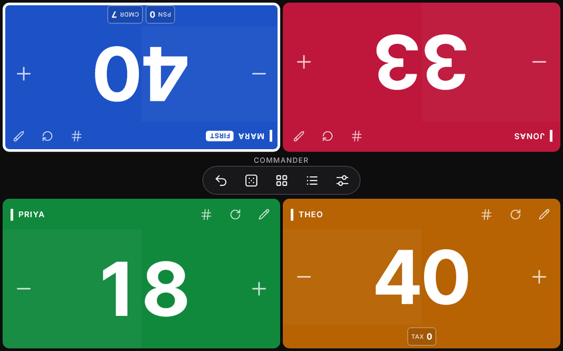
</p>

## Build from source

You need JDK 17+. For the Android build you also need the Android SDK, with `sdk.dir` set in `local.properties`.

```bash
./gradlew :composeApp:run                         # run on desktop
./gradlew :composeApp:desktopTest                 # unit, database and offscreen UI render tests
./gradlew :composeApp:assembleDebug               # Android debug APK
./gradlew :composeApp:assembleRelease             # Android release APK (signed if keystore.properties exists)
./gradlew :composeApp:packageUberJarForCurrentOS  # desktop JAR for this OS
./gradlew :composeApp:packageExe                  # Windows .exe installer (packageMsi also works; needs WiX 3)
./gradlew :composeApp:packageDeb                  # Linux .deb (packageRpm for .rpm)
```

Release signing reads `keystore.properties` from the repo root. That file is git-ignored and has these keys:

```properties
storeFile=keystore/chronoscore-release.jks
storePassword=…
keyAlias=chronoscore
keyPassword=…
```

Native installers are built for the OS and CPU architecture of the build host. For example, Linux ARM64 packages have to be built on an ARM64 machine.

Desktop data is stored in these locations:

| Platform | Database |
| --- | --- |
| Windows | `%APPDATA%\Chronoscore\chronoscore.db` |
| Linux | `$XDG_DATA_HOME/chronoscore/` (default `~/.local/share/chronoscore/`) |

Pass `-Dchronoscore.db=<path>` to override the location.

## Project layout

Everything lives in `composeApp/src/commonMain/kotlin/io/chronoscore/`:

| Path | Contents |
| --- | --- |
| `model/` | Immutable data models |
| `engine/` | The pure reducer (`GameEngine.reduce`): coalescing, batch undo, bulk edits |
| `random/` | Dice, coin and seat randomizers |
| `data/` | The SQLDelight repository (migrations in `sqldelight/…/*.sqm`), JSON backups and CSV export |
| `viewmodel/` | The `StateFlow` ViewModel: autosave, library, settings |
| `ui/` | The board, dialogs, and the design system (`ui/theme`) |

Other folders:

| Path | Contents |
| --- | --- |
| `docs/ui-kit/` | The Chronoscore UI Kit the interface follows |
| `tools/` | Icon and documentation image generators |

## Credits

Fonts: [Inter and Inter Tight](https://github.com/rsms/inter), SIL Open Font License 1.1 (see `docs/licenses/Inter-OFL.txt`).
