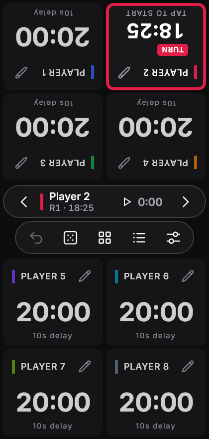
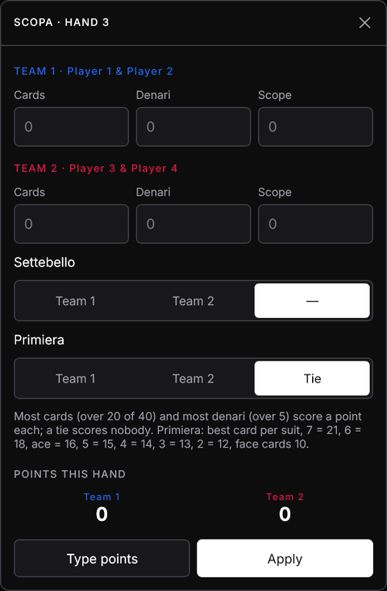

# Chronoscore user guide

Chronoscore keeps score on one shared screen. Put the device in the middle of the table, or pass it around. Everything stays on the device: there's no account, no sync and no network.

For the full illustrated guide, open **[docs/guide/index.html](guide/index.html)** in a browser.

Everything new in 1.1 (turns, timers, win rules, presets, round sheet, MTG extras, stats and backups) is an **optional per-match setting**. With all of it off, the table works exactly like 1.0.

## Opening the app

  
  

When Chronoscore opens, it asks what to play before showing the table:

- **Continue** (or tap the *Last match* card) puts your most recent match back on the table, with its game, players, round and when it was last played. Closing the screen does the same.
- **New game** opens the new-game setup: a preset or your own players, starting score and options. See [Menu and new games](#menu-and-new-games).
- **Saved matches** lists every match by game, so you can pick an older one to continue.

Starting a new game never deletes the last match. It stays in Saved matches.

## The table

  
  

Each player has a **seat**, a card showing their name, their score and any counters.

- **The left half subtracts and the right half adds.** Tap a half for ±1. Hold it to repeat, and after about a second it switches to steps of ±5.
- While you count, the **running delta** (for example **−7**) shows next to the name. When you pause, it folds into the match log as one entry, so one undo reverts the whole press.
- **Seats in the top half are rotated 180°** so they face the players sitting across from the device. To turn a seat by hand, tap its **⟲** rotate button. Each tap turns it 30°, so a seat can face a player at a corner or along the side of the table. *Edit seat* also has **−30° / +30°** and **Flip 180°**. A tilted seat shrinks to stay inside its space.
- The header buttons are **#** (keypad), **⟲** (rotate) and **✎** (edit seat). On narrow phone seats only ✎ is shown. The other actions are inside the seat editor.

The layout adapts to how many players there are and to the orientation. On a phone, up to 8 seats fit:

## The center hub

The pill between the two halves of the table holds the shared controls. When the turn tracker or a clock is on, the turn bar sits just above it, and a winner banner appears once a match is decided.

| Button | Action |
| --- | --- |
| ↶ Undo | Reverts the last change (or the last batch). It's dimmed when the log is empty. |
| ⚄ Dice | Opens the table utilities |
| ▦ Edit all seats | Changes a score or counter on many seats at once |
| ☰ Log | Opens the match log, organized by round |
| ⚌ Menu (sliders) | Current game, match options, saved matches, appearance and new games |

When the match has a game name and the screen is wide enough (tablets, landscape, desktop), it shows at the left of the hub (for example **CATAN**). Tap it to open the menu. The name always shows in the menu and in the match log title.

## Match options

Open **Menu → Match options** to change the match on the table (changes apply immediately), or **Menu → New game → Options** for the next match. A [preset](#presets) can set them for you.

### Turn tracker

One seat is active: it gets a ring and a **TURN** tag, and the **turn bar** appears on the center line.

- **Next ›** passes the turn to the next seat. After the last seat, the round advances.
- **‹ Previous** passes it back. Before the first seat, the round goes back one (never below 1). In darts there is no Previous: **Undo** takes back the last dart and gives the turn back with it.
- Seats that are out are skipped. A seat that concedes on its own turn hands the turn on.
- **Edit seat → Give turn** jumps to any seat.

### Match clock, seat timers and turn limit

- **Match clock:** total match time, shown in the turn bar.
- **Seat timers:** each seat's own time on its turns, like a chess clock (needs the turn tracker).
- **Turn limit:** a countdown per turn (30 s, 1, 2 or 5 min). Past the limit, the time turns rose and counts overtime.
- **⏸ / ▶** in the turn bar pauses and resumes. The clock also pauses by itself when you leave the app or close the window.

### Timer mode (chess clock for 1–8 seats)

For any game where each player has a fixed amount of thinking time, such as chess, Go, or long board games where turns drag on. Turn on **Timer mode** and each seat becomes a large clock tile that counts down its own time bank.

- **Time per seat:** 1, 3, 5, 10, 15, 30 or 60 minutes.
- **Bonus per turn:**
  - **None.**
  - **Increment:** the seat gains 2, 5, 10 or 30 s after every turn it finishes in time (Fischer).
  - **Delay:** the first seconds of each turn are free, and only time past the delay comes off the bank.
- **When time runs out:**
  - **Seat is out:** the seat is dimmed with *OUT OF TIME* and skipped from then on. The last seat left wins.
  - **Overtime:** the clock keeps going below zero in red, and nobody is knocked out.

The clock starts paused. Tap the active seat's tile (*TAP TO START*) to start it. After that, **tapping your own tile ends your turn** and starts the next seat's clock, just like pressing a chess clock. Other tiles ignore taps, so a stray touch can't pass the turn. The tile turns red in the last 10 seconds. ⏸ in the turn bar pauses everyone. **Edit seat → −1 min / +1 min** corrects a clock, gives a handicap, or brings back a seat that ran out by mistake. Scores are still in the seat editor (*Set score*).

Timer mode turns the turn tracker on. Seats take turns in seat order, and the turn bar shows the active seat's remaining time.

### Winning and elimination

| Rule | How it works |
| --- | --- |
| None | No automatic result. When everyone else is marked out (**Edit seat → Mark as out**), the last seat wins. |
| Target | The match ends when a seat reaches the target. *Highest wins* or *Lowest wins* (e.g. Hearts to 100). |
| Out ≤ (elimination) | Seats at or below the threshold (0 by default) are **OUT**. The last seat standing wins. |
| Out ≥ | For penalty points: seats at or above the threshold (101 by default, as in Scala 40) are **OUT**. The last seat standing wins. |

Seats that are out are dimmed but stay editable. Results are worked out from the scores, so **Undo brings an eliminated seat back**.

### Round sheet

A scorepad instead of seat cards: one column per seat, one row per round, totals at the bottom. Tap a cell to enter that seat's points for the round (earlier rounds too). **Next round →** adds a row.

#### Hand calculators

With a **Hand calculator** chosen (Match options → Layout & games, or set by the card and bocce presets), tapping a round opens a calculator for the whole hand. It shows each seat's points before you **Apply**; applying the current round moves the sheet on to the next one, and one Undo reverts the whole hand. **Type points** goes back to the plain keypad.

| Calculator | You enter | Points |
| --- | --- | --- |
| Scopa | Cards, denari and scope per side; who took the settebello and the primiera | 1 each for most cards, most denari (a tie scores nobody), settebello, primiera; +1 per scopa |
| Burraco | Clean and dirty burrachi, cards on the table and in hand, pozzetto taken, who closed | +200 / +100 per burraco, +100 for closing, −100 without the pozzetto, + table − hand |
| Briscola | One side's card points | 61 of 120 wins the hand (1 point); 60–60 is a draw |
| Bocce | The side closest to the jack and how many bocce | Only that side scores |
| Scala 40 | Who closed; for the others, opened or not and the cards in hand | 0 for closing, 100 for not opening, else the cards in hand |

Card values are listed in each calculator: Burraco jolly 30, pinella 20, ace 15, 8–K 10, 3–7 5; Scala 40 ace 11, faces 10, numbers face value, jolly 25; primiera 7 = 21, 6 = 18, ace = 16, 5 = 15, 4 = 14, 3 = 13, 2 = 12, faces 10.

### Darts

Choose a game under **Match options → Darts** (or a darts preset). Seat scores sit on top, the visit in progress below them, and a keypad at the bottom: pick **Single / Double / Treble**, then the number (the ring goes back to Single after each dart). **25** is the single bull; with Double it is the bull's eye (50). After three darts, a bust or a win the turn passes by itself; **Next** in the turn bar ends a visit early, counting the darts not thrown as misses. **Undo** takes back one dart, and a bust or a win with it.

| Game | Rules |
| --- | --- |
| X01 (301, 501, 701) | Count down to exactly 0. With *double out* the last dart must be a double (or the bull's eye); going below 0, or to 1, is a bust and the visit doesn't count. *Double in* starts scoring with a double. The active seat shows a checkout, e.g. *T20 T20 Bull* for 170. |
| Cricket | Three marks close 15–20 or the bull (a treble closes in one). Extra marks score the number while an opponent still has it open. Close everything without trailing on points to win. |
| Around the Clock | Hit 1 to 20 in order, then the bull. Any ring counts as one hit. First to the bull wins. |
| Shanghai | Round n aims at n; doubles and trebles multiply. Single, double and treble of n in one visit wins outright; otherwise the highest score after 7 (or 20) rounds wins. |

Changing the darts settings starts the scores over.

### Teams

A seat can be a team whose members share its score: choose **Teams of 2** (or 3) under **Menu → New game**, or **Edit seat → Make this seat a team**. Add members by name or from your saved players, and remove them in the same place (remove all of them to make it a single seat again). Member names show under the team name, and **Players & stats** counts a team's result for each member.

### Magic: The Gathering extras

- **Commander damage:** each seat has a **CMDR** chip; tap it to track damage from each opponent's commander. It also comes off that seat's life, as one undo step.
- **Monarch** and **Initiative:** assign from a seat's editor.
- **Day / Night:** set in Table utilities; shown in the turn bar.
- With Elimination on, **21 commander damage** from one commander or **10 Poison** also knocks a seat out.

## Presets

Pick a preset under **Menu → New game** to fill in players, starting score, counters and options:

| Preset | Setup |
| --- | --- |
| Commander | 4 at 40, Poison, turn tracker, Elimination, MTG extras |
| Magic 1v1 | 2 at 20, Poison, Elimination, MTG extras |
| Hearts | 4 at 0, Round sheet, Target 100, lowest wins |
| Race to 10 | 4 at 0, turn tracker, Target 10 |
| Catan | 4 at 0, turn tracker, Target 10 |
| Carcassonne | 4 at 0, turn tracker |
| Uno / Rummy 500 | 4 at 0, Round sheet, Target 500 |
| Skyjo | 4 at 0, Round sheet, Target 100, lowest wins |
| Chess clock | 2 players, timer mode: 10 min each, +5 s increment, out on time |
| Board game timer | 4 players, timer mode: 20 min each, 10 s delay, overtime; match clock |
| Bocce · Raffa / Pétanque | 2 sides, Round sheet with the bocce calculator, Target 12 / 13 |
| Briscola | 2 sides, Round sheet with the Briscola calculator, Target 2 hands |
| Scopa / Scopone | 2 players / 2 teams of 2, Round sheet with the Scopa calculator, Target 11 |
| Scala 40 | 4 players, Round sheet with the Scala 40 calculator, out at 101 |
| Burraco | 2 teams of 2, Round sheet with the Burraco calculator, Target 2005 |
| Darts 501 / 301, Cricket, Around the Clock, Shanghai | 2 players, darts board |

**Save as preset** stores your own setup. Select a saved preset to delete it.

## Keypad

Open it with **#** on a seat, or by tapping a counter's value.

- **Set** replaces the value, and **+ Add** / **− Sub** change it by the amount you type.
- **±** makes a Set value negative.
- **Only *name* / All seats** chooses the scope: the change applies to this seat only, or to every seat at once.

A keypad opened from a flipped seat is turned to face that player.

## Counters

Each seat holds up to **4 counters** (for example Poison, Commander, Energy, VP, Fouls, Tax, or one you name yourself). To add them to one seat, use **+ COUNTER** or **✎ → Counters**. To add them to the whole table, use **Menu → Counters on every seat**:

Turning a counter on adds it to every seat at 0. A half-filled switch means the counter is only on some seats. Seats that already hold 4 counters are skipped, and their names are listed.

## Edit all seats

1. Pick the seats (or **All**).
2. Pick what to change: **Score** or a counter by name.
3. Choose **Set to**, **+ Add** or **− Sub**.

Each seat shows its preview as *old → new*. **Apply** writes one log entry per seat, and a single **Undo** reverts all of them.

## Table utilities

- **Dice:**
  - d4, d6, d8, d10, d12 and d20, or a custom **dX** from 2 to 1000.
  - **Dice per roll** rolls several dice and shows their total.
- **Flip coin:** heads or tails.
- **First player:** picks a random seat. That seat gets a ring and a **FIRST** tag for a few seconds.
- **Turn order:** a random order of all players.
- **Day / Night** (MTG extras on).

## Match log

Every change is listed under its round, with the player, what changed, the change (green for up, red for down) and the resulting value.

- **Next round →** starts a new round. With the turn tracker on it is hidden, because passing the last seat's turn already moves the round on.
- **Undo** reverts the most recent entry.

## Saved matches and game history

Every match is saved automatically and kept until you delete it. Each match has its own players, counters and log. In **Saved matches** (from the menu or the log):

- Matches are **grouped by game** and sorted with the most recently played first.
- **Continue** brings a match back to the table exactly as you left it.
- The 🗑 button deletes a match. You have to tap it a second time to confirm.
- The 🗑 next to a game's name deletes the whole game: every match filed under it, for good (tap **Delete game** to confirm). If the match on the table is one of them, your most recent remaining match comes back to the table, or a new match starts. Presets with that game name are kept.
- **This match belongs to** files the current match under a game. You can type a name or tap a game you've played before.

### Backup, import and CSV

Nothing is uploaded, and uninstalling the Android app deletes its data, so keep a backup file:

- **Export all** saves one `.json` file with every match, preset and saved player, wherever you choose.
- **Import** adds a backup's contents. Ones with the same id are replaced, and the match on the table is never overwritten. Backups work across Android, Windows and Linux.
- **This match as CSV** saves the current match for a spreadsheet: every change, then the final standings.

## Players and stats

**Menu → Players & stats** lists every player across saved matches: matches played, wins and win rate, average and best score, time on turns. Filter by game with the chips.

- Wins count only matches with a result (a win rule, or everyone else marked out).
- In **Edit seat → Saved player**, save a seat as a player or pick an existing one, so stats follow them even if the seat is renamed. Other seats are counted by name.

## Menu and new games

The menu has three sections:

- **Current game:**
  - **This match's game:** names the game on the table (for example Catan). It's saved right away, shown on the hub and in the match log, and used to group the match in Saved matches. A note confirms where the match is filed.
  - Edit all seats and Counters on every seat.
  - Add seat, and Reset scores (tap it twice to confirm).
  - Match options, Saved matches, and Players & stats.
- **Appearance:**
  - **Seat style:** *Neutral* (dark cards with a color bar) or *Colored* (each card filled with the seat's color).
  - **Theme:** System, Dark or Light.
- **New game:**
  - A **preset**, or your own setup.
  - An optional **game for the new match**. This only names the next match; to rename the current one, use *This match's game* above.
  - The number of players and a starting score (20, 30, 40 or a custom value).
  - **Options** for the new match, and **Save as preset**.
  - **Start new game** asks for a second tap.

  The **New game** button on the start screen opens this same setup on its own.

  Starting a new game clears the table but never deletes a match. The one you leave stays in Saved matches, so you can continue it.

## Editing a seat

Tap a seat's name or **✎** to rename it, set its score, turn it (30° steps, or flip 180°), change its color, manage its counters, or remove the seat (tap twice to confirm). Depending on the match options it also has **Give turn**, **Mark as out / Back in**, **Clock −1 min / +1 min** (timer mode), **Monarch**, **Initiative**, and **Saved player**.

## Desktop

The desktop app works the same way. Click the halves to count, and click and hold to repeat. On wide windows the seat headers show the keypad and rotate buttons directly. Closing the window saves the match and pauses its clock.

## Your data

Data stays only on your device:

| Platform | Where it's stored |
| --- | --- |
| Android | Private app storage. It's excluded from cloud backup and device transfer. |
| Windows | `%APPDATA%\Chronoscore\chronoscore.db` |
| Linux | `~/.local/share/chronoscore/chronoscore.db` |

Uninstalling the Android app deletes its data, so export a backup first. On desktop, delete the file to start fresh.
