# Chronoscore user guide

Chronoscore keeps score on one shared screen. Put the device in the middle of the table, or pass it around. Everything stays on the device: there's no account, no sync and no network.

For the full illustrated guide, open **[docs/guide/index.html](guide/index.html)** in a browser.

Everything new in 1.1 (turns, timers, win rules, presets, round sheet, MTG extras, stats and backups) is an **optional per-match setting**. With all of it off, the table works exactly like 1.0.

## The table

  
  

Each player has a **seat**, a card showing their name, their score and any counters.

- **The left half subtracts and the right half adds.** Tap a half for ±1. Hold it to repeat, and after about a second it switches to steps of ±5.
- While you count, the **running delta** (for example **−7**) shows next to the name. When you pause, it folds into the match log as one entry, so one undo reverts the whole press.
- **Seats in the top half are rotated 180°** so they face the players sitting across from the device. To turn a seat by hand, use the rotate button (or *Edit seat → Rotate 180°*).
- The header buttons are **#** (keypad), **⟲** (rotate) and **✎** (edit seat). On narrow phone seats only ✎ is shown. The other actions are inside the seat editor.

The layout adapts to how many players there are and to the orientation. On a phone, up to 8 seats fit:

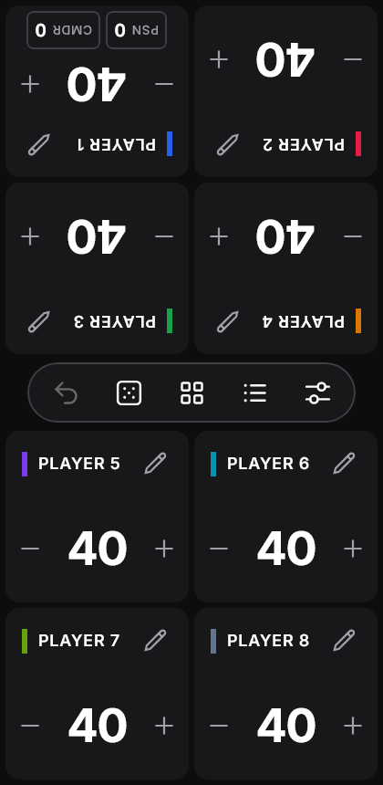

## The center hub

The pill between the two halves of the table holds the shared controls. When the turn tracker or a clock is on, the turn bar sits just above it, and a winner banner appears once a match is decided.

| Button | Action |
| --- | --- |
| ↶ Undo | Reverts the last change (or the last batch). It's dimmed when the log is empty. |
| ⚄ Dice | Opens the table utilities |
| ▦ Edit all seats | Changes a score or counter on many seats at once |
| ☰ Log | Opens the match log, organized by round |
| ⚌ Menu (sliders) | Current game, match options, saved matches, appearance and new games |

## Match options

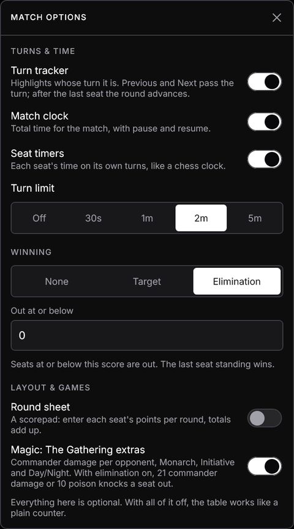

Open **Menu → Match options** to change the match on the table (changes apply immediately), or **Menu → New game → Options** for the next match. A [preset](#presets) can set them for you.

### Turn tracker

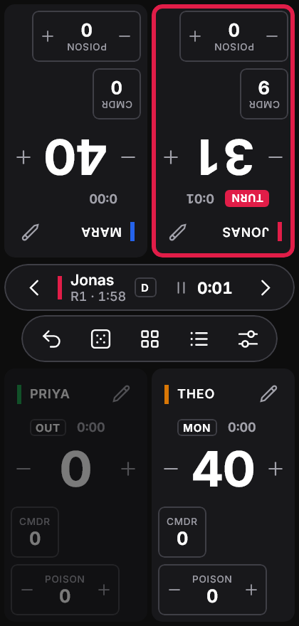

One seat is active: it gets a ring and a **TURN** tag, and the **turn bar** appears on the center line.

- **Next ›** passes the turn to the next seat. After the last seat, the round advances.
- **‹ Previous** passes it back. Before the first seat, the round goes back one (never below 1).
- Seats that are out are skipped. A seat that concedes on its own turn hands the turn on.
- **Edit seat → Give turn** jumps to any seat.

### Match clock, seat timers and turn limit

- **Match clock:** total match time, shown in the turn bar.
- **Seat timers:** each seat's own time on its turns, like a chess clock (needs the turn tracker).
- **Turn limit:** a countdown per turn (30 s, 1, 2 or 5 min). Past the limit, the time turns rose and counts overtime.
- **⏸ / ▶** in the turn bar pauses and resumes. The clock also pauses by itself when you leave the app or close the window.

### Winning and elimination

| Rule | How it works |
| --- | --- |
| None | No automatic result. When everyone else is marked out (**Edit seat → Mark as out**), the last seat wins. |
| Target | The match ends when a seat reaches the target. *Highest wins* or *Lowest wins* (e.g. Hearts to 100). |
| Elimination | Seats at or below the threshold (0 by default) are **OUT**. The last seat standing wins. |

Seats that are out are dimmed but stay editable. Results are worked out from the scores, so **Undo brings an eliminated seat back**.

### Round sheet

A scorepad instead of seat cards: one column per seat, one row per round, totals at the bottom. Tap a cell to enter that seat's points for the round (earlier rounds too). **Next round →** adds a row.

### Magic: The Gathering extras

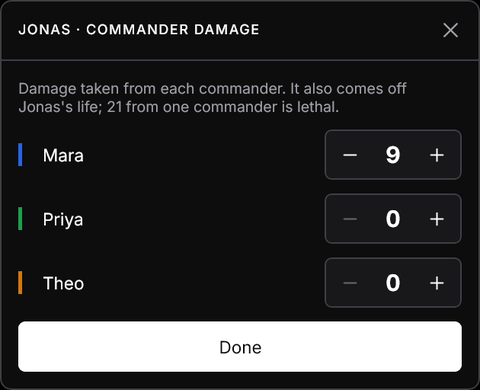

- **Commander damage:** each seat has a **CMDR** chip; tap it to track damage from each opponent's commander. It also comes off that seat's life, as one undo step.
- **Monarch** and **Initiative:** assign from a seat's editor.
- **Day / Night:** set in Table utilities; shown in the turn bar.
- With Elimination on, **21 commander damage** from one commander or **10 Poison** also knocks a seat out.

## Presets

Pick a preset under **Menu → New game** to fill in players, starting score, counters and options:

| Preset | Setup |
| --- | --- |
| Commander | 4 at 40, Poison, turn tracker, Elimination, MTG extras |
| Magic 1v1 | 2 at 20, Poison, Elimination, MTG extras |
| Hearts | 4 at 0, Round sheet, Target 100, lowest wins |
| Race to 10 | 4 at 0, turn tracker, Target 10 |
| Chess clock | 2 players, turn tracker, match clock, seat timers |

**Save as preset** stores your own setup. Select a saved preset to delete it.

## Keypad

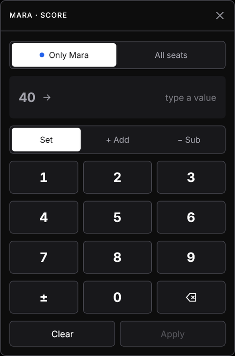

Open it with **#** on a seat, or by tapping a counter's value.

- **Set** replaces the value, and **+ Add** / **− Sub** change it by the amount you type.
- **±** makes a Set value negative.
- **Only *name* / All seats** chooses the scope: the change applies to this seat only, or to every seat at once.

A keypad opened from a flipped seat is turned to face that player.

## Counters

Each seat holds up to **4 counters** (for example Poison, Commander, Energy, VP, Fouls, Tax, or one you name yourself). To add them to one seat, use **+ COUNTER** or **✎ → Counters**. To add them to the whole table, use **Menu → Counters on every seat**:

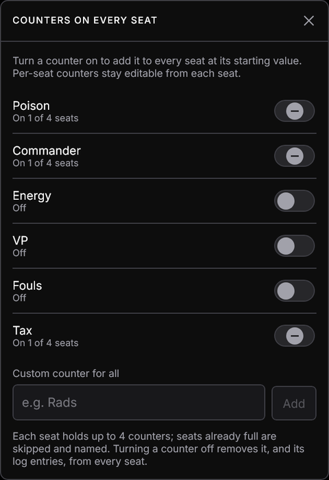

Turning a counter on adds it to every seat at 0. A half-filled switch means the counter is only on some seats. Seats that already hold 4 counters are skipped, and their names are listed.

## Edit all seats

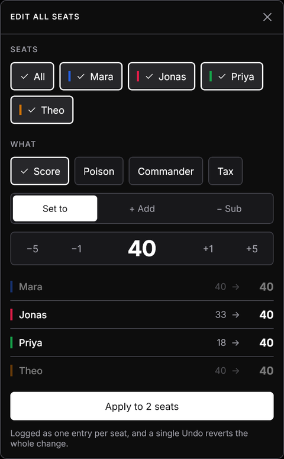

1. Pick the seats (or **All**).
2. Pick what to change: **Score** or a counter by name.
3. Choose **Set to**, **+ Add** or **− Sub**.

Each seat shows its preview as *old → new*. **Apply** writes one log entry per seat, and a single **Undo** reverts all of them.

## Table utilities

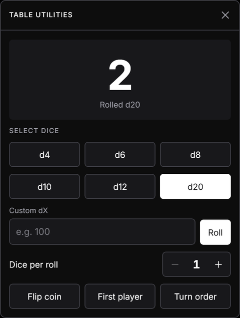

- **Dice:**
  - d4, d6, d8, d10, d12 and d20, or a custom **dX** from 2 to 1000.
  - **Dice per roll** rolls several dice and shows their total.
- **Flip coin:** heads or tails.
- **First player:** picks a random seat. That seat gets a ring and a **FIRST** tag for a few seconds.
- **Turn order:** a random order of all players.
- **Day / Night** (MTG extras on).

## Match log

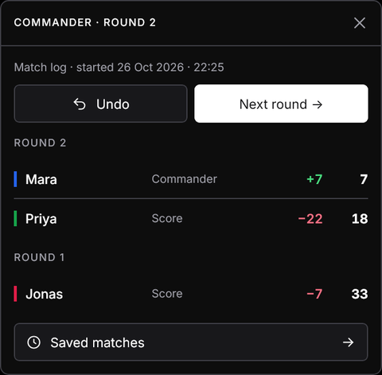

Every change is listed under its round, with the player, what changed, the change (green for up, red for down) and the resulting value.

- **Next round →** starts a new round.
- **Undo** reverts the most recent entry.

## Saved matches and game history

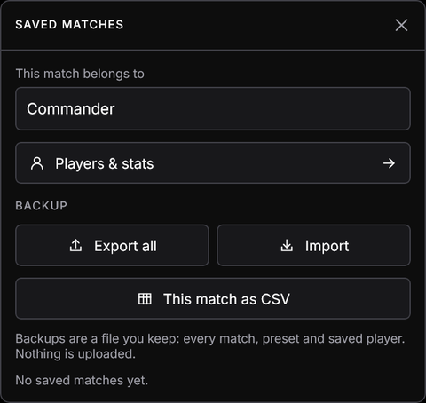

Every match is saved automatically and kept until you delete it. Each match has its own players, counters and log. In **Saved matches** (from the menu or the log):

- Matches are **grouped by game** and sorted with the most recently played first.
- **Continue** brings a match back to the table exactly as you left it.
- The 🗑 button deletes a match. You have to tap it a second time to confirm.
- **This match belongs to** files the current match under a game. You can type a name or tap a game you've played before.

### Backup, import and CSV

Nothing is uploaded, and uninstalling the Android app deletes its data, so keep a backup file:

- **Export all** saves one `.json` file with every match, preset and saved player, wherever you choose.
- **Import** adds a backup's contents. Ones with the same id are replaced, and the match on the table is never overwritten. Backups work across Android, Windows and Linux.
- **This match as CSV** saves the current match for a spreadsheet: every change, then the final standings.

## Players and stats

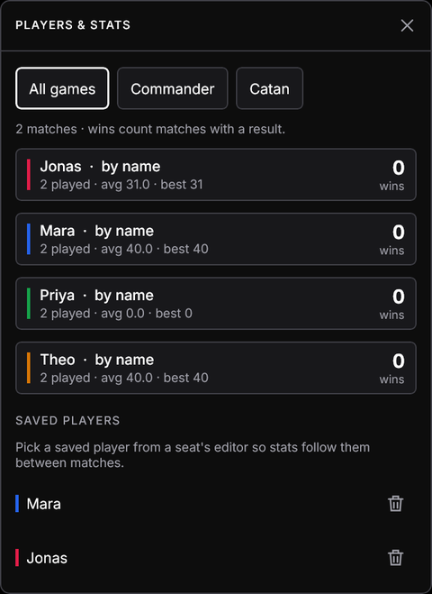

**Menu → Players & stats** lists every player across saved matches: matches played, wins and win rate, average and best score, time on turns. Filter by game with the chips.

- Wins count only matches with a result (a win rule, or everyone else marked out).
- In **Edit seat → Saved player**, save a seat as a player or pick an existing one, so stats follow them even if the seat is renamed. Other seats are counted by name.

## Menu and new games

The menu has three sections:

- **Current game:**
  - Edit all seats and Counters on every seat.
  - Add seat, and Reset scores (tap it twice to confirm).
  - Match options, Saved matches, and Players & stats.
- **Appearance:**
  - **Seat style:** *Neutral* (dark cards with a color bar) or *Colored* (each card filled with the seat's color).
  - **Theme:** System, Dark or Light.
- **New game:**
  - A **preset**, or your own setup.
  - An optional **game name**, so the match is filed under that game's history.
  - The number of players and a starting score (20, 30, 40 or a custom value).
  - **Options** for the new match, and **Save as preset**.

  The match you leave stays in Saved matches.

## Editing a seat

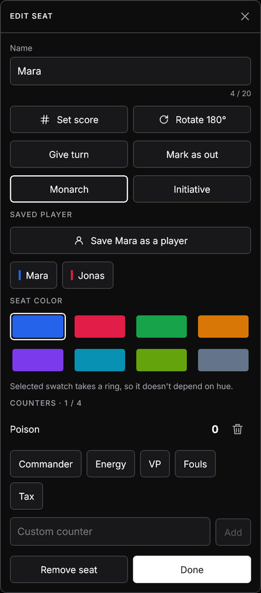

Tap a seat's name or **✎** to rename it, set its score, rotate it, change its color, manage its counters, or remove the seat (tap twice to confirm). Depending on the match options it also has **Give turn**, **Mark as out / Back in**, **Monarch**, **Initiative**, and **Saved player**.

## Desktop

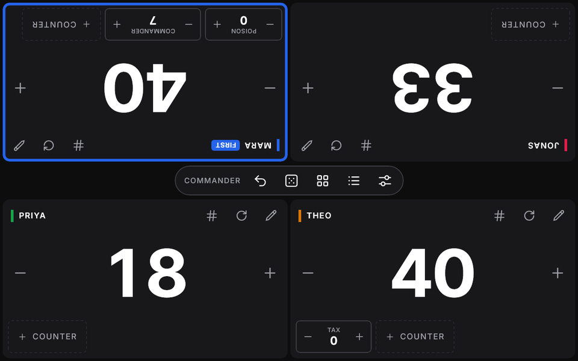

The desktop app works the same way. Click the halves to count, and click and hold to repeat. On wide windows the seat headers show the keypad and rotate buttons directly. Closing the window saves the match and pauses its clock.

## Your data

Data stays only on your device:

| Platform | Where it's stored |
| --- | --- |
| Android | Private app storage. It's excluded from cloud backup and device transfer. |
| Windows | `%APPDATA%\Chronoscore\chronoscore.db` |
| Linux | `~/.local/share/chronoscore/chronoscore.db` |

Uninstalling the Android app deletes its data, so export a backup first. On desktop, delete the file to start fresh.
